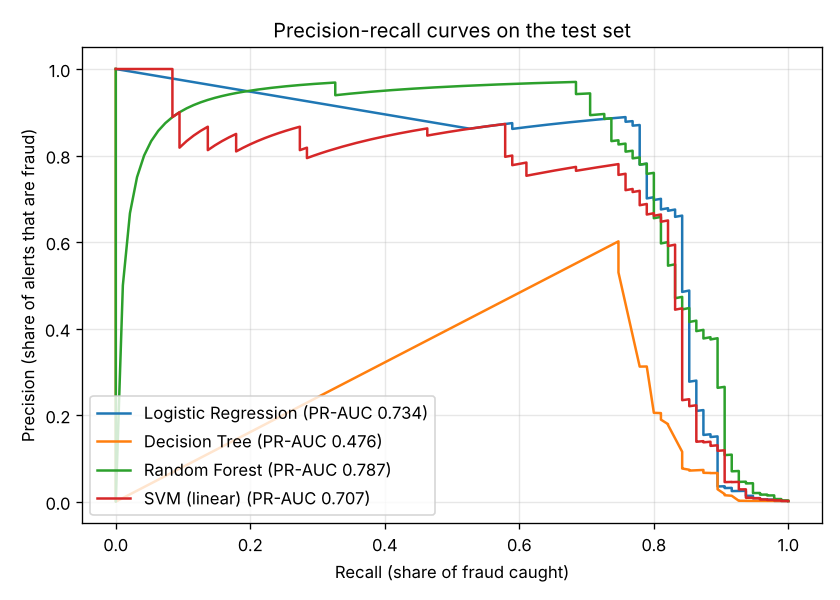

# SecureBank: AI-Powered Fraud Detection

SecureBank is a web application that imports bank transactions, scores them for fraud with a machine-learning model, and lets analysts review suspicious cases from one dashboard.

This repository is built in stages:

1. **Fraud model** (done): train and compare four classifiers on the Kaggle credit-card dataset.
2. Flask backend and SQLite database: CSV import, prediction API, login and roles.
3. Dashboard and case review: fraud statistics, transaction search, alerts and investigation notes.
4. Testing, security and documentation.

## Setup

```bash
python -m venv venv
source venv/bin/activate          # Windows: venv\Scripts\activate
pip install -r requirements.txt
```

## Dataset

Download **Credit Card Fraud Detection** from Kaggle and save it as `data/raw/creditcard.csv`. The file is about 150 MB and is not committed to git.

It has 284,807 transactions, of which 492 are fraud. Columns are `Time`, `V1` to `V28` (anonymised features), `Amount` and `Class` (1 = fraud). It also contains 1,081 duplicate rows, which the loader removes.

To try the code without the real file, generate fake data with the same columns:

```bash
python -m ml.sample_data --rows 20000 --out data/raw/sample.csv
python -m ml.train --data data/raw/sample.csv
```

## Training the model

```bash
python -m ml.train
```

A run takes about 2 to 3 minutes on a laptop. It does the following:

1. Loads the CSV, checks the columns and drops duplicates.
2. Splits the data 60/20/20 into train, validation and test sets, keeping the same fraud rate in each.
3. Trains four pipelines, each of which scales the features, balances the classes with SMOTE (training data only) and fits a classifier:
   - Logistic Regression (baseline)
   - Decision Tree (readable rules)
   - Random Forest (ensemble)
   - Linear SVM (a kernel SVM would take hours on 170k rows)
4. Picks the model with the best **PR-AUC** on the validation set, then picks its alert threshold to maximise F1 on the validation set.
5. Scores the untouched test set once and writes the results to `ml/artifacts/`:
   - `model.joblib` (the saved pipeline, not committed) and `model_meta.json`
   - `metrics.json` and `comparison.txt`
   - `pr_curves.png` and `confusion_matrix.png`

Pass `--no-smote` to use class weights instead of SMOTE.

### Why not accuracy?

Only 0.17% of transactions are fraud, so a model that calls everything legitimate would still be 99.8% accurate. These metrics are reported instead:

- **Precision:** the share of alerts that really are fraud.
- **Recall:** the share of fraud that gets caught.
- **F1:** the balance between precision and recall.
- **PR-AUC:** precision and recall across every threshold. This is the main metric used to choose the model.
- **ROC-AUC:** reported for completeness.

## Results on creditcard.csv

These are test-set results (56,746 transactions, 95 of them fraud) from `ml/artifacts/comparison.txt`:

| Model | Precision | Recall | F1 | PR-AUC | ROC-AUC | Missed fraud | False alerts |
|---|---|---|---|---|---|---|---|
| Logistic Regression | 0.888 | 0.747 | 0.811 | 0.734 | 0.968 | 24 | 9 |
| Decision Tree | 0.602 | 0.747 | 0.667 | 0.476 | 0.927 | 24 | 47 |
| **Random Forest** | 0.885 | 0.726 | 0.798 | **0.788** | 0.987 | 26 | 9 |
| SVM (linear) | 0.755 | 0.747 | 0.751 | 0.707 | 0.970 | 24 | 23 |

Random Forest had the highest validation PR-AUC, so it is the saved model. At its chosen threshold it catches about 73% of fraud, and about 88% of its alerts are real fraud.



## Scoring new transactions

```python
import pandas as pd
from ml.predict import FraudModel

model = FraudModel()
scores, suspicious = model.score(pd.read_csv("new_transactions.csv"))
```

A score is a ranking of how suspicious a transaction is, not a calibrated probability of fraud.

## Tests

```bash
pytest
```

The tests use generated data, so they run without the real dataset.

## Project layout

```
ml/
  preprocess.py   load, validate and split the dataset
  train.py        build, train and compare the four models
  evaluate.py     metrics, threshold choice and charts
  predict.py      load the saved model and score new rows
  sample_data.py  generate fake data with the same columns
  artifacts/      saved model, metrics and charts
data/raw/         creditcard.csv goes here (not committed)
tests/            pytest tests
```
