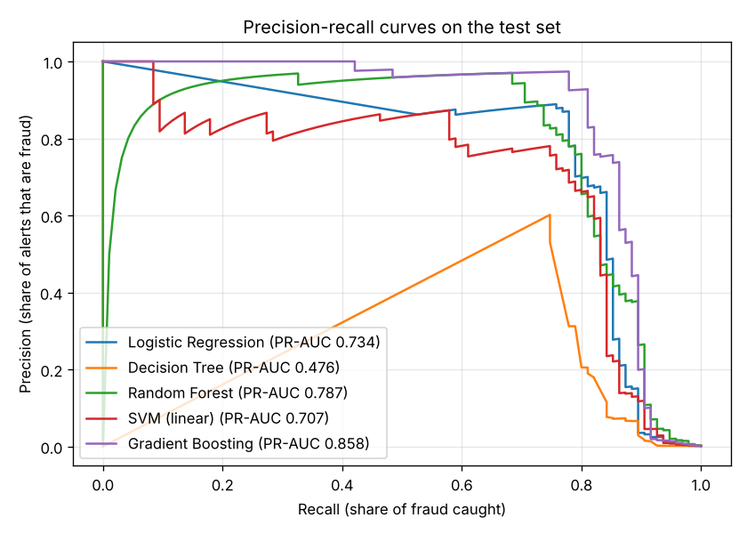
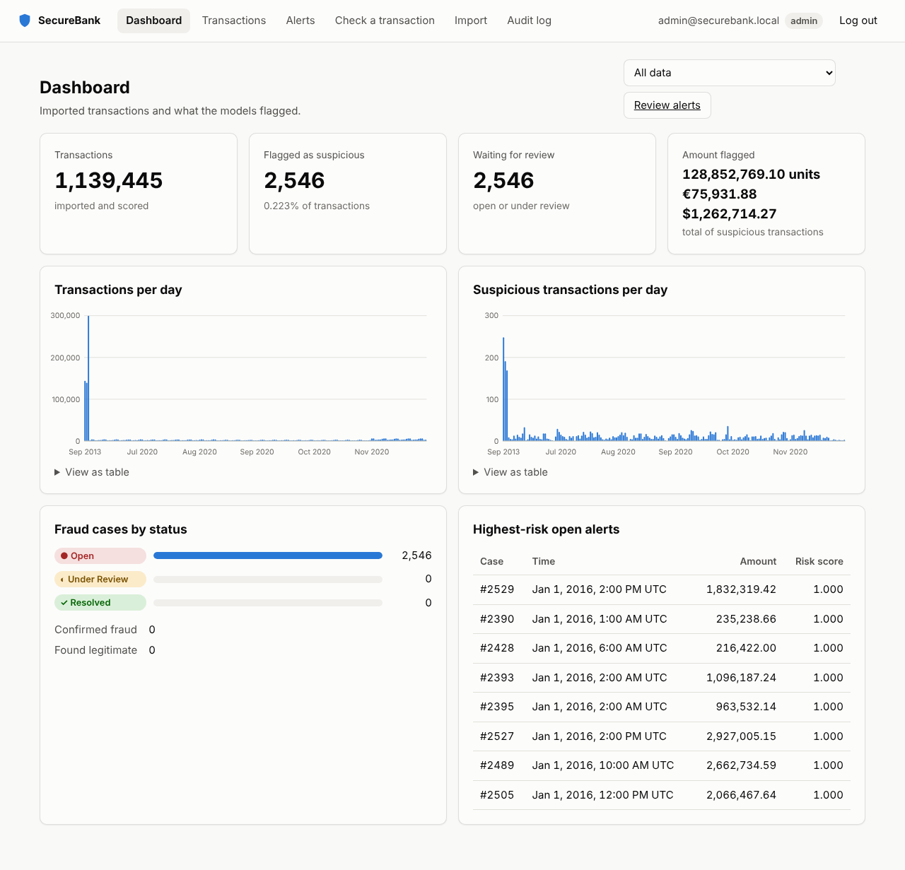
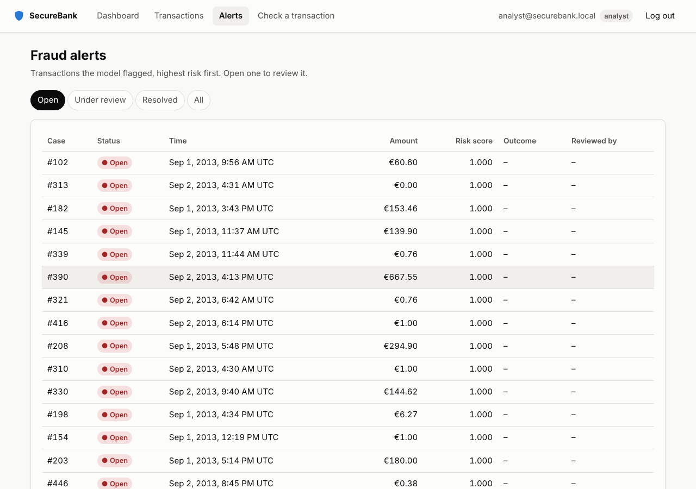
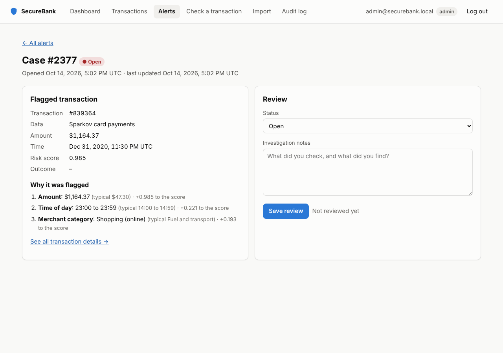
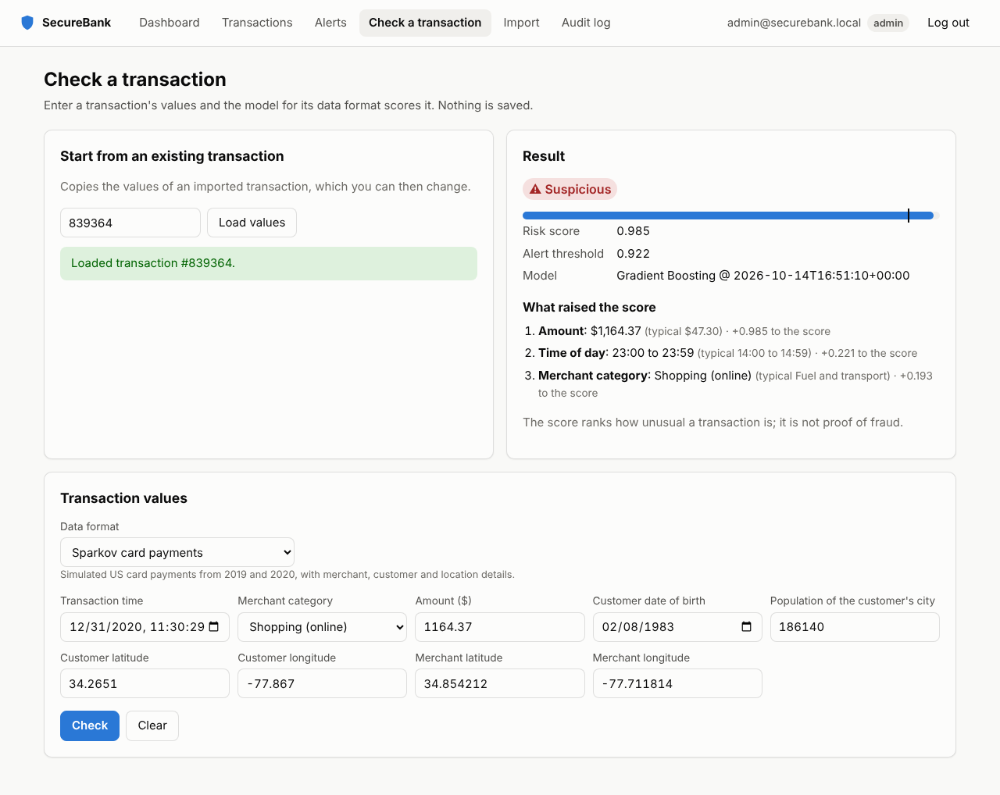
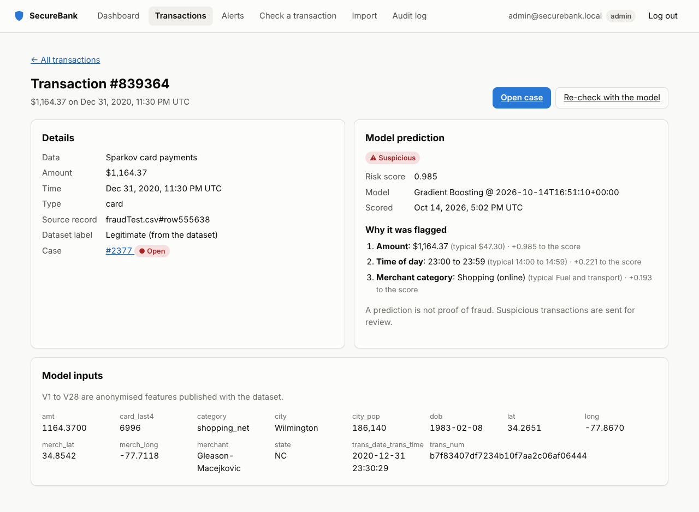
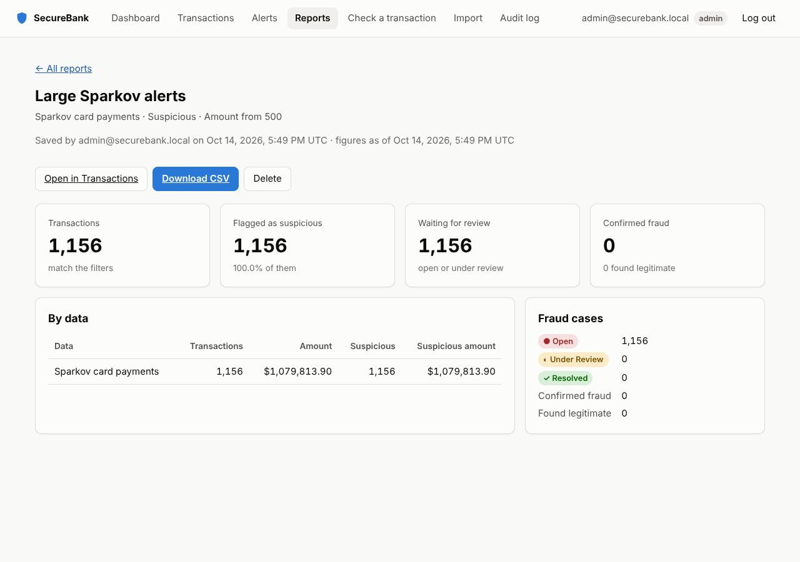

# SecureBank: AI-Powered Fraud Detection

[](https://github.com/Im-manojkumar/Secure-Bank/actions/workflows/tests.yml)

SecureBank is a web application that imports bank transactions, scores them for fraud with machine-learning models, explains why each suspicious transaction was flagged, and lets analysts review suspicious cases from one dashboard.

This repository is built in stages:

1. **Fraud model** (done): train and compare classifiers on the Kaggle credit-card dataset.
2. **Flask backend and SQLite database** (done): CSV import, prediction API, login and roles.
3. **Dashboard and case review** (done): fraud statistics, transaction search, alerts and investigation notes.
4. **Testing, security and documentation** (done): audit log, login limits, CSRF and CSP protection, automated tests on GitHub, and architecture and test-case docs.
5. **More datasets and explanations** (done): separate models for the Sparkov and PaySim datasets, gradient boosting as a fifth model, and the reasons behind each alert.
6. **Saved reports** (done): name a transaction search, re-run it with live totals, and download the results as CSV.

## Setup

```bash
python -m venv venv
source venv/bin/activate          # Windows: venv\Scripts\activate
pip install -r requirements.txt
```

## Datasets

SecureBank understands three public fraud datasets. Each one has its own columns, so each gets its own model, and the app recognises a file's format from its columns. Save the files in `data/raw/`; none of them is committed to git.

| Format | Download | Rows (fraud) | What a row is | Currency |
|---|---|---|---|---|
| `creditcard` | Kaggle "Credit Card Fraud Detection", saved as `creditcard.csv` | 284,807 (492) | A European card payment from two days in September 2013. `V1` to `V28` are anonymised PCA features | EUR |
| `sparkov` | Kaggle "Credit Card Transactions Fraud Detection Dataset" (`fraudTrain.csv` and `fraudTest.csv`) | 1,852,394 (9,651) | A simulated US card payment from 2019 and 2020, with merchant category, time, customer age and locations | USD |
| `paysim` | Kaggle "Synthetic Financial Datasets For Fraud Detection", renamed to `paysim.csv` | 6,362,620 (8,213) | A simulated mobile-money transfer, with account balances before and after | none (shown as "units") |

The model inputs for each format are defined in `ml/datasets.py`:

- **creditcard:** `Time`, `V1` to `V28` and `Amount`, used as they are.
- **sparkov:** amount, hour of day, night-time, day of week, customer age, city population, distance between customer and merchant, merchant category, and the card's history: payments in the hour and day before, the amount against the card's average, hours since its last payment, and how many earlier payments it has. Names, street, job, ZIP code, gender and the full card number are never stored or used. Only the card's last four digits and a keyed hash of its number (`card_id`, which links its payments) are kept. Gender is left out of the model so that it cannot treat men and women differently.
- **paysim:** transfer type, amount, the four balances, whether the transfer empties the account, and how far each balance fails to add up after the transfer.

To try the code without the real files, generate fake data in any format:

```bash
python -m ml.sample_data --dataset sparkov --rows 20000 --out data/raw/sample.csv
python -m ml.train --dataset sparkov --data data/raw/sample.csv
```

## Training the models

```bash
python -m ml.train                                          # creditcard, about 2 minutes
python -m ml.train --dataset sparkov --data data/raw/fraudTrain.csv --test-data data/raw/fraudTest.csv
python -m ml.train --dataset paysim --data data/raw/paysim.csv --max-train-rows 1000000
```

Sparkov and PaySim take about 5 to 10 minutes each and need a few GB of memory, mostly to load the files. Each run does the following:

1. Loads the CSV, checks the columns, skips invalid rows and drops duplicates.
2. Splits the data by time into train, validation and test sets, the way a deployed model meets new data: it learns from the past and is judged on what comes next. Credit card and PaySim are split 60/20/20, so the test set is the latest 20% of transactions. Sparkov comes with a later test file, so the earliest 75% of `fraudTrain.csv` is for training, the latest 25% for validation, and `fraudTest.csv` is the test set. Pass `--random-split` to shuffle rows instead; that mixes the same days into every set and overstates accuracy, so use it only for comparison.
3. With `--max-train-rows`, keeps every fraud row in the training set but only a sample of the genuine ones. PaySim uses this to train on 1 million of its 3.8 million training rows. The validation and test sets keep their real mix.
4. Trains five pipelines, each of which scales the inputs, balances the classes with SMOTE (training data only) and fits a classifier:
   - Logistic Regression (baseline)
   - Decision Tree (readable rules)
   - Random Forest (ensemble)
   - Linear SVM (a kernel SVM would take hours on this many rows)
   - Gradient Boosting (trees that each correct the ones before)
5. Picks the model with the best **PR-AUC** on the validation set, then picks the alert threshold that costs least on the validation set. Each alert costs a fixed review fee, 10 in the dataset's currency by default (`--review-cost`), and each fraud the model misses costs its full amount. `--threshold-rule f1` picks the threshold with the best F1 instead, as earlier versions did.
6. Scores the untouched test set once and writes the results to `ml/artifacts/<format>/`:
   - `model.joblib` (the saved pipeline, not committed) and `model_meta.json`
   - `metrics.json` and `comparison.txt`
   - `pr_curves.png` and `confusion_matrix.png`

Pass `--no-smote` to use class weights instead of SMOTE.

### Learning from analysts

Every case an analyst resolves as **Confirmed fraud** or **Legitimate** is a label the model can learn from, and the most useful ones are its own mistakes. Retrain with those verdicts added to the training data:

```bash
flask --app app retrain --dataset sparkov --data data/raw/fraudTrain.csv --test-data data/raw/fraudTest.csv
```

The reviewed transactions join the training set only. Any that are also validation or test rows are skipped, so the reported scores stay honest. The current model is first copied to `ml/artifacts/<format>/previous/<trained_at>/`, so it can be put back. The retrain is written to the audit log, and `model_meta.json` records how many reviewed cases it learned from. Restart the app to start scoring with the new model.

### Why not accuracy?

Fraud is under 1% of every dataset, so a model that calls everything legitimate would still be over 99% accurate. These metrics are reported instead:

- **Precision:** the share of alerts that really are fraud.
- **Recall:** the share of fraud that gets caught.
- **F1:** the balance between precision and recall.
- **PR-AUC:** precision and recall across every threshold. This is the main metric used to choose the model.
- **ROC-AUC:** reported for completeness.

## Results

These are test-set results from `ml/artifacts/<format>/comparison.txt`. The saved model for each format is in bold.

The models are tested on the latest transactions, after the ones they learned from. Each threshold is the one that cost least on the validation set, with each alert costing 10 to review and each missed fraud costing its amount. Total cost is that sum on the test set.

### Credit card (56,746 test transactions, 74 fraud)

| Model | Precision | Recall | F1 | PR-AUC | ROC-AUC | Missed fraud | False alerts | Total cost |
|---|---|---|---|---|---|---|---|---|
| Logistic Regression | 0.942 | 0.662 | 0.778 | 0.751 | 0.981 | 25 | 3 | €3,857 |
| Decision Tree | 0.654 | 0.716 | 0.684 | 0.479 | 0.832 | 21 | 28 | €4,697 |
| Random Forest | 0.915 | 0.730 | 0.812 | 0.805 | 0.964 | 20 | 5 | €3,238 |
| SVM (linear) | 0.587 | 0.730 | 0.651 | 0.649 | 0.980 | 20 | 38 | €3,921 |
| **Gradient Boosting** | 0.893 | 0.676 | 0.769 | **0.785** | 0.968 | 24 | 6 | €4,530 |

Gradient Boosting had the best validation score, so it is the saved model, even though Random Forest did slightly better on the test set. Picking by the test set would make the test result meaningless.

Here the cost rule does a little worse than the best-F1 threshold: €4,530 against €4,276, because it misses two more frauds. The validation period holds only 57 frauds, too few to set a cost-based threshold reliably. The larger datasets below show the rule working.

With the earlier random split, the same model scored PR-AUC 0.858 and caught 74 of 95 test frauds. That split mixed both days of the dataset into training and testing, so the model was partly tested on the same day it learned from. The time split is the honest figure.

### Sparkov (555,719 test transactions, 2,145 fraud)

| Model | Precision | Recall | F1 | PR-AUC | ROC-AUC | Missed fraud | False alerts | Total cost |
|---|---|---|---|---|---|---|---|---|
| Logistic Regression | 0.192 | 0.706 | 0.301 | 0.196 | 0.964 | 631 | 6,384 | $142,831 |
| Decision Tree | 0.309 | 0.742 | 0.436 | 0.315 | 0.987 | 554 | 3,556 | $104,766 |
| Random Forest | 0.305 | 0.911 | 0.457 | 0.795 | 0.995 | 191 | 4,459 | $87,680 |
| SVM (linear) | 0.165 | 0.709 | 0.267 | 0.227 | 0.950 | 624 | 7,715 | $180,381 |
| **Gradient Boosting** | 0.609 | 0.900 | 0.727 | **0.902** | 0.998 | 215 | 1,238 | $64,983 |

Each payment is compared with the same card's earlier payments: how many it made in the hour and day before, the amount against the card's average, the time since its last payment, and how many payments it has made before. Card fraud tends to come in bursts of unusual amounts, which a single payment on its own does not show. These inputs raise test PR-AUC from 0.869 to 0.902, and at a similar catch rate (90% instead of 92%) the false alerts fall from 3,134 to 1,238.

The cost rule pays off here too. It sets the threshold at 0.324 instead of the best-F1 threshold of 0.718, so the model catches 1,930 of 2,145 frauds instead of 1,761, at the price of 1,238 false alerts instead of 310. Missed fraud falls from $73,977 to $33,303, and the total cost, reviews included, falls from $94,687 to $64,983, 31% less. Because most fraud here is worth hundreds of dollars, a $10 review is worth doing on fairly weak suspicion. `comparison.txt` shows both thresholds side by side. Before the card history inputs, the same rule cost $69,852.

Linear models do badly here because fraud depends on combinations, such as a large online purchase late at night, that a single straight line cannot separate.

### PaySim (1,293,438 test transactions, 4,244 fraud)

| Model | Precision | Recall | F1 | PR-AUC | ROC-AUC | Missed fraud | False alerts | Total cost |
|---|---|---|---|---|---|---|---|---|
| Logistic Regression | 0.125 | 0.988 | 0.222 | 0.801 | 0.995 | 53 | 29,392 | 74,687,446 |
| Decision Tree | 1.000 | 1.000 | 1.000 | 1.000 | 1.000 | 0 | 1 | 42,450 |
| **Random Forest** | 1.000 | 0.993 | 0.997 | **1.000** | 1.000 | 30 | 0 | 71,271,588 |
| SVM (linear) | 0.102 | 0.989 | 0.185 | 0.772 | 0.995 | 49 | 36,813 | 74,730,468 |
| Gradient Boosting | 1.000 | 0.996 | 0.998 | 1.000 | 1.000 | 19 | 0 | 43,526,258 |

The near-perfect score is a quirk of the simulator, not proof of a perfect model. In PaySim, fraudulent transfers almost always empty the account and leave balances that do not add up, which real bank data would not give away so easily. The score stays near-perfect under the time split, which confirms that the simulator, not mixed-up days, is the reason. The cost rule and the best-F1 rule pick the same threshold here. The 30 missed frauds still cost 71 million units, because PaySim fraud empties whole accounts. The last week of the simulation holds far more fraud than the rest (4,244 of 1.29 million test rows, against 3,173 of 3.79 million training rows).



## Why a transaction was flagged

When a model flags a transaction, SecureBank also records which inputs raised its score most. It replaces each input in turn with the value of a typical genuine transaction (the median, or the most common category), scores the transaction again, and reports how much the score drops. The three inputs with the biggest drop are stored with the prediction and shown on the transaction, case and check pages. A real flagged Sparkov transaction reads:

1. **Amount:** $890.22 (typical $47.30) · +0.995 to the score
2. **Time of day:** 22:00 to 22:59 (typical 14:00 to 14:59) · +0.086 to the score
3. **Merchant category:** Other (online) (typical Fuel and transport) · +0.032 to the score

On real Sparkov fraud the most common reasons are the amount, then the time of day and the merchant category. The code is in `ml/explain.py`. The typical values come from the training data and are saved in `model_meta.json`.

## Scoring new transactions

```python
import pandas as pd
from ml.predict import FraudModel

model = FraudModel("ml/artifacts/sparkov")
rows = pd.read_csv("new_transactions.csv")
scores, suspicious = model.score(rows)
reasons = model.explain(rows[suspicious])
```

A score is a ranking of how suspicious a transaction is, not a calibrated probability of fraud.

## Running the app

```bash
export SECRET_KEY=change-me                       # Windows: set SECRET_KEY=change-me
python -m ml.train                                # once per format you will import
flask --app app init-db
flask --app app create-user admin@securebank.local --role admin
flask --app app import-csv data/raw/creditcard.csv
flask --app app run
```

Then open http://127.0.0.1:5000 and log in.

Import Sparkov's `fraudTest.csv` or `paysim.csv` the same way. Importing the credit card file takes about a minute and makes a database of about 350 MB in `instance/securebank.db`, which is not committed. Importing the same rows again skips them as duplicates.

A database created before step 5 lacks the new `dataset` and `explanation` columns. Delete `instance/securebank.db` and run `init-db` again, because `init-db` only creates missing tables, not missing columns. A step 5 or later database only needs `init-db` run again: it adds new tables, and new optional columns such as `transactions.card_id`.

There are two roles. An **admin** can do everything, including importing files. An **analyst** can search transactions, run predictions and review fraud cases.

### What happens on import

An upload is checked straight away: a file that is not CSV, matches no format, or has no trained model is refused at once. The file is then saved and queued, and the upload returns. A background worker imports it, saving 5,000 rows at a time, and the import page shows its progress ("Saved 20,000 new rows of 60,000…"). You can leave the page; the history table shows the result. Saving in chunks also means a long import never blocks other users: SQLite lets one write happen at a time, and logins, which write to the audit log, now answer in under a quarter of a second during a 200,000-row import. If an import stops part-way, the rows already saved stay, and importing the file again adds the rest, since saved rows are skipped as duplicates.

Who runs the worker depends on `IMPORT_MODE`. The default, `thread`, runs it in a background thread of the web server, which suits `flask run`. In production, `IMPORT_MODE=worker` leaves imports to a separate `flask --app app import-worker` process, so restarting the web server never cuts an import short; `docker-compose.yml` runs one. An import that saves no progress for 30 minutes is marked failed.

Then, for every file:

1. The format is recognised from the file's columns. A file missing a required column of its closest format is rejected with the names of the missing columns, and the failed import is still recorded. The import page lists the columns each format needs.
2. Rows with non-numeric values, a negative amount, an unknown category or date, or a fraud label other than 0 or 1 are skipped and counted.
3. Duplicate rows are skipped, whether they repeat within the file or were imported before.
4. Every row is scored by that format's model. Each transaction, its prediction and, when it is flagged, an **Open** fraud case are stored in separate tables, so an analyst's finding never overwrites what the model said. Flagged rows also store the three inputs that raised their score.
5. The file is checked for **drift**: whether its transactions still look like the ones the model learned from. Each input group and the model's scores are compared with their spread on the validation set, using the population stability index (PSI). Below 0.1 is stable, 0.1 to 0.25 is a moderate shift, and above 0.25 is a major shift that makes the scores unreliable. A shift is written into the import message and shown on the dashboard until a newer import of that format is stable. Files under 200 rows are not judged. Inputs that grow with time by design, such as credit card `Time`, are left out.
6. Credit card `Time` is turned into a date by counting seconds from 1 September 2013, when that dataset begins. PaySim's `step` counts hours from 1 January 2016, a made-up start because the simulator has no real dates. Sparkov has real dates.

### Pages

| Page | What it shows |
|---|---|
| Dashboard (`/`) | Totals, the fraud rate, cases waiting for review, flagged amounts per currency, transactions and suspicious transactions over time, cases by status, and the highest-risk open alerts, for all data or one format |
| Transactions (`/transactions`) | Search by format, date, amount, prediction, case status and import, with each result linking to a detail page with the model inputs and why it was flagged. Save the search as a report, or download it as CSV |
| Alerts (`/alerts`) | Fraud cases, highest risk first, with tabs for Open, Under review, Resolved and All |
| Reports (`/reports`) | Searches the team has saved. Opening one runs it again and shows its totals per format, its fraud cases and their outcomes, with a CSV download |
| Case (`/cases/<id>`) | The flagged transaction, why it was flagged, and a review form for status, outcome and investigation notes |
| Check a transaction (`/predict`) | Pick a format, score any set of values and see what raised the score, or start from an imported transaction and change it |
| Import (`/import`, admins only) | Upload a CSV and follow the import's progress while it runs in the background, and see the history of past imports |
| Audit log (`/audit`, admins only) | Every login, failed login, import, case change and new user, with filters |



| Alerts | Case review | Check a transaction |
|---|---|---|
|  |  |  |





The pages are plain HTML, CSS and JavaScript with no build step and no external libraries. Each page fetches its data from the JSON API below, and the charts are drawn as SVG. Light and dark mode follow the system setting, and the layout works on phone screens.

### API

Every endpoint except login and the live scoring API needs a logged-in session cookie. Errors come back as `{"error": "..."}`.

| Method and path | Who | What it does |
|---|---|---|
| `POST /api/auth/login` | anyone | Log in with JSON `{"email", "password"}`, plus `"code"` once two-factor login is on. Without the code the answer is 401 with `"two_factor_required": true` |
| `POST /api/auth/logout` | logged in | Log out |
| `GET /api/auth/me` | logged in | The current user |
| `POST /api/auth/2fa/setup` | logged in | Start two-factor setup: returns a new secret and its `otpauth://` link |
| `POST /api/auth/2fa/enable` | logged in | Finish setup with `{"code"}` from the app |
| `POST /api/auth/2fa/disable` | logged in, not a required admin | Turn it off with `{"password", "code"}` |
| `POST /api/transactions/import` | admin | Upload a CSV as form field `file`; the format is detected from its columns. Returns 202 with the queued import |
| `GET /api/sources` | logged in | Past imports and their results |
| `GET /api/sources/<id>` | logged in | One import, with its status (`queued`, `processing`, `completed` or `failed`) and `rows_processed` so far |
| `GET /api/transactions` | logged in | Search, with filters `dataset`, `source_id`, `date_from`, `date_to`, `min_amount`, `max_amount`, `prediction` (`suspicious` or `low_risk`) and `status` |
| `GET /api/transactions/<id>` | logged in | One transaction with its model inputs and explanation |
| `GET /api/models` | logged in | Each format, its input fields and its trained model's threshold and test results |
| `POST /api/predict` | logged in | Score one transaction sent as JSON, without saving it. `dataset` picks the format (default `creditcard`); the other keys are that format's input fields. The answer includes the explanation |
| `GET /api/alerts` | logged in | Fraud cases with the highest risk first, optionally filtered with `?status=Open` and `?dataset=sparkov` |
| `GET /api/cases/<id>` | logged in | One fraud case |
| `GET /api/reports` | logged in | Saved reports, newest first |
| `POST /api/reports` | admin, analyst | Save a search as JSON `{"name", "filters"}`, where `filters` takes the same keys as `/api/transactions` |
| `GET /api/reports/<id>` | logged in | A report with its current totals per format, case counts and outcomes |
| `DELETE /api/reports/<id>` | owner or admin | Delete a report; the transactions are not affected |
| `GET /api/reports/<id>/export` | logged in | Download a report's transactions as CSV, at most `EXPORT_MAX_ROWS` (100,000) rows |
| `GET /api/transactions/export` | logged in | Download a search as CSV, with the same filters as `/api/transactions`. Add `check=1` to only ask whether it is within the limit |
| `PATCH /api/cases/<id>` | admin, analyst | Update `status` (`Open`, `Under Review` or `Resolved`), `review_notes` and `outcome` (`Confirmed fraud` or `Legitimate`, required to resolve a case) |
| `GET /api/audit` | admin | Audit log, newest first, with filters `action` and `subject` |
| `GET /api/dashboard/summary` | logged in | Totals, predicted fraud, flagged amounts per currency, cases by status and a trend by day, or by hour with `?granularity=hour`; `?dataset=` limits it to one format |

List endpoints take `page` and `per_page` (at most 100).

### Live scoring API

Imports score transactions after the fact. A payment system can instead ask before it approves a payment, with an API key rather than a login:

```bash
flask --app app create-api-key "Card switch"      # prints the key once
curl -H "Authorization: Bearer sbk_..." -H "Content-Type: application/json" \
  -d '{"dataset":"sparkov","card_number":"4111111111111111","transaction":{"trans_date_trans_time":"2020-07-01 23:30:00","category":"shopping_net","amt":950,"dob":"1970-05-01","city_pop":25000,"lat":40.0,"long":-100.0,"merch_lat":40.5,"merch_long":-100.5}}' \
  http://127.0.0.1:5000/api/v1/score
```

The answer has a `decision`: **approve** below the model's alert threshold, **review** at or above it (approve, but open a case for an analyst), and **decline** at a risk score of `DECLINE_SCORE` (0.98) or more. It also has the risk score, the reasons, the model version and `latency_ms`. With the real Sparkov model the median is about 28 ms and the 95th percentile about 41 ms, including the card history lookup and saving, measured over 200 calls on the development machine.

The transaction, prediction and any case are saved like an imported row, under a source named "Live API: <key name>", so they appear on the dashboard and in the alert queue. `card_number` is optional and only used by Sparkov, to compare the payment with the card's history; it is never stored. Sending the same transaction again (a retry) returns the first answer and saves nothing new. `flask --app app revoke-api-key <first 12 characters>` turns a key off. Only a SHA-256 hash of each key is stored.

Example with curl:

```bash
curl -c cookies.txt -H "Content-Type: application/json" \
  -d '{"email":"admin@securebank.local","password":"..."}' http://127.0.0.1:5000/api/auth/login
curl -b cookies.txt "http://127.0.0.1:5000/api/alerts?status=Open&per_page=5"
curl -b cookies.txt -X PATCH -H "Content-Type: application/json" \
  -d '{"status":"Under Review","review_notes":"Called the cardholder"}' http://127.0.0.1:5000/api/cases/1
```

## Security

The main protections are:
- **Passwords:** stored as salted scrypt hashes.
- **Login limit:** 5 failed logins per email and IP address in 15 minutes.
- **Two-factor login:** a 6-digit code from an authenticator app after the password. Admins must set it up on the Account page (click your email at the top right) before they can use anything else; analysts can turn it on there. Codes follow RFC 6238, accept one 30-second step of clock difference, and cannot be used twice. `REQUIRE_2FA_FOR_ADMINS=0` turns the admin requirement off for local experiments.
- **Roles:** checked on every route.
- **Cross-site requests:** blocked by `SameSite` cookies and an `Origin` check.
- **Scripts and styles:** a strict Content-Security-Policy, with no inline scripts or styles on any page.
- **Audit log:** every sensitive action is recorded, including every CSV download.
- **CSV downloads:** cells that a spreadsheet would run as a formula are made plain text, and downloads are capped at 100,000 rows.

[docs/ARCHITECTURE.md](docs/ARCHITECTURE.md#security) lists each risk, how it is handled, and the known limits.

## Deploying

`flask run` is for development only. [docs/DEPLOYMENT.md](docs/DEPLOYMENT.md) runs SecureBank on a server with Docker: gunicorn serves the app, and Caddy in front of it gets an HTTPS certificate and renews it.

```bash
cp deploy/env.example .env        # then fill in SECRET_KEY, CARD_ID_KEY and SITE_ADDRESS
docker compose up -d --build
docker compose exec app flask create-user admin@yourbank.example --role admin
```

With `SECUREBANK_ENV=production`, which the Docker image sets:
- The app refuses to start without a long random `SECRET_KEY` and `CARD_ID_KEY`. `CARD_ID_KEY` keys the hash that links a card's payments without storing its number, so set it before the first import and never change it.
- Cookies are sent only over HTTPS, and browsers are told to use HTTPS for a year.
- Errors are logged with their tracebacks, and visitors see only "Something went wrong".
- `/api/health` checks the database, for uptime monitors.

`flask --app app backup-db` copies the database safely while the app is running and keeps the newest 14 copies. The deployment guide schedules it every night.

## Tests

```bash
pytest
```

There are 167 tests, which run on GitHub for every push and pull request. They use generated data and an in-memory database, so they run without the real dataset. [docs/TEST_CASES.md](docs/TEST_CASES.md) lists every case with its expected result. They cover the model pipeline, every API endpoint (login, roles, import validation, duplicate detection, filters and the case workflow) every page (login redirects, admin-only pages and safe redirects after login), the audit log, the security protections, each dataset format with its explanations, saved reports with their CSV downloads, the production settings, and background imports.

## Project layout

```
app.py            Flask app factory and CLI commands (init-db, create-user, import-csv, import-worker, retrain, create-api-key, revoke-api-key, backup-db)
config.py         settings, overridable with environment variables
models.py         database tables
routes/           API endpoints (auth, transactions, alerts, reports, dashboard, audit) and HTML pages (pages.py)
templates/        Jinja page templates
static/           CSS and JavaScript for the pages
services/         import, prediction, search and case logic used by the routes
ml/
  datasets.py     the three formats: columns, cleaning and model inputs
  preprocess.py   load, validate and split a dataset
  train.py        build, train and compare the five models
  evaluate.py     metrics, threshold choice and charts
  explain.py      which inputs raised a transaction's score
  predict.py      load a saved model, score and explain new rows
  sample_data.py  generate fake data in each format
  artifacts/      one folder per format with its model, metrics and charts
docs/             architecture, deployment guide, test cases and screenshots
Dockerfile        production image (gunicorn); docker-compose.yml adds Caddy for HTTPS
deploy/           Caddyfile and the example .env
data/raw/         the dataset CSVs go here (not committed)
tests/            pytest tests
instance/         local SQLite database (not committed)
```
