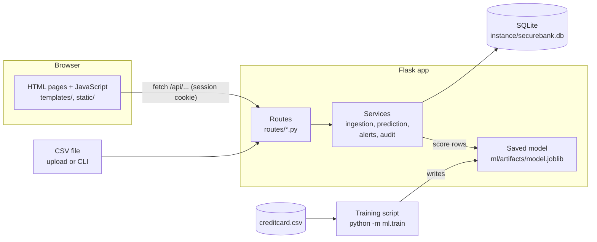
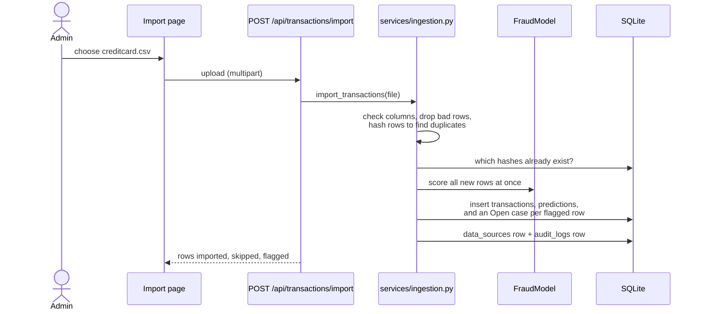
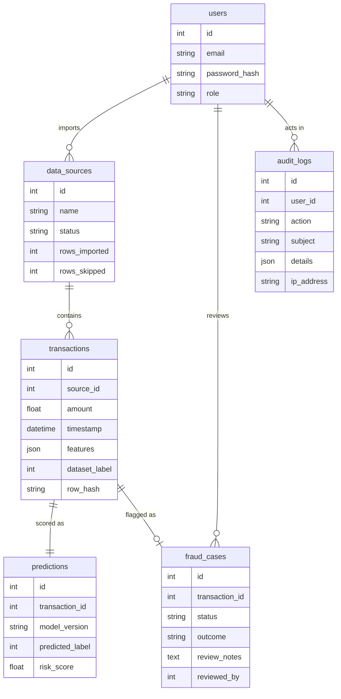

# SecureBank architecture

SecureBank is a single Flask application with a SQLite database and a scikit-learn model saved to disk. A browser loads HTML pages from Flask, and each page's JavaScript calls the app's JSON API.

## Components

| Layer | Files | Job |
|---|---|---|
| Pages | `templates/`, `static/js/`, `static/css/` | Show data and forms. They hold no business logic and only call the API. |
| Routes | `routes/*.py` | Check login and role, validate input, and return JSON or HTML. |
| Services | `services/*.py` | Import, scoring, case rules and audit logging, kept out of the routes so they can be tested and reused by the CLI. |
| Model | `ml/*.py`, `ml/artifacts/` | Training, evaluation and a `FraudModel` class that loads the saved pipeline. |
| Data | `models.py`, `instance/securebank.db` | Six tables, described below. |

## What happens when a file is imported

## Data model

The imported record, the model's prediction and the analyst's outcome sit in three separate tables. A reviewer marking a case "Legitimate" never changes what the model predicted, so the two can be compared later. `dataset_label` keeps the Kaggle `Class` value for evaluation only, and the app never uses it to make decisions.

## The model

- **Data:** the Kaggle credit-card dataset, with 284,807 transactions and 492 frauds. 1,081 duplicate rows are dropped.
- **Split:** 60% train, 20% validation and 20% test, stratified so each part keeps the 0.17% fraud rate.
- **Pipeline:** `StandardScaler`, then `SMOTE`, then the classifier. SMOTE runs only while fitting, so validation and test rows are never resampled.
- **Candidates:** Logistic Regression, Decision Tree, Random Forest and a linear SVM.
- **Selection:** the highest PR-AUC on the validation set picks the model. Its alert threshold is the one that gives the best F1 on the validation set. The test set is scored once, at the end.
- **Result:** Random Forest, with test PR-AUC 0.788, precision 0.885 and recall 0.726 at threshold 0.815.

## Security

| Risk | Protection | Where |
|---|---|---|
| Stolen or guessed passwords | Passwords are stored as salted scrypt hashes and never in plain text. Login errors read the same for unknown emails and wrong passwords. | `models.User`, `routes/auth.py` |
| Password guessing | After 5 failed logins for one email from one IP address within 15 minutes, logins are refused with HTTP 429. The count resets after a successful login. | `services/audit.py`, `routes/auth.py` |
| Unauthorised access | Every page and API route needs a login. Importing and the audit log need the admin role. | `routes/auth.py` (`role_required`), `routes/pages.py` |
| Cross-site request forgery | Session cookies are `SameSite=Lax` and `HttpOnly`. API writes whose `Origin` header names another site are rejected. | `config.py`, `app.py` (`reject_cross_site_writes`) |
| Cross-site scripting | Pages insert user text with `textContent` only. A strict Content-Security-Policy allows only the app's own scripts and styles, with no inline code, and a test checks every page for inline code. | `static/js/common.js`, `app.py` |
| Clickjacking, MIME sniffing, caching | `X-Frame-Options: DENY`, `frame-ancestors 'none'`, `X-Content-Type-Options: nosniff`, and `Cache-Control: no-store` on API responses. | `app.py` (`security_headers`) |
| Open redirect after login | `?next=` only follows paths on the same site. | `routes/pages.py` (`_safe_next`) |
| Bad uploads | Files over 200 MB are refused. Files must be CSV with the expected columns, and invalid rows are skipped and counted. | `config.py`, `services/ingestion.py` |
| Untraceable changes | Logins, failed logins, imports, case changes and new users are written to `audit_logs`, in the same transaction as the change. | `services/audit.py` |
| Leaked secrets or data | `SECRET_KEY` comes from the environment. The dataset, database and trained model are git-ignored. | `config.py`, `.gitignore` |

The app never asks for or stores bank passwords, PINs, CVVs, OTPs or access tokens. A real bank integration would go through an authorised provider's API and consent flow, as section 10 of the project spec describes.

### Known limits

- The login limit counts attempts in the database, keyed by email and IP address. Someone using many IP addresses could still guess slowly. A production system would add a per-account lock and multi-factor login.
- `flask run` serves plain HTTP. In production, put the app behind HTTPS and set `SESSION_COOKIE_SECURE=1`.
- SQLite suits one server. The spec's planned move to PostgreSQL only needs `DATABASE_URL` changed, plus one SQLite-specific `strftime` call in `routes/dashboard.py`.
- A score above the threshold opens a case for a person to review. It never blocks a payment.
