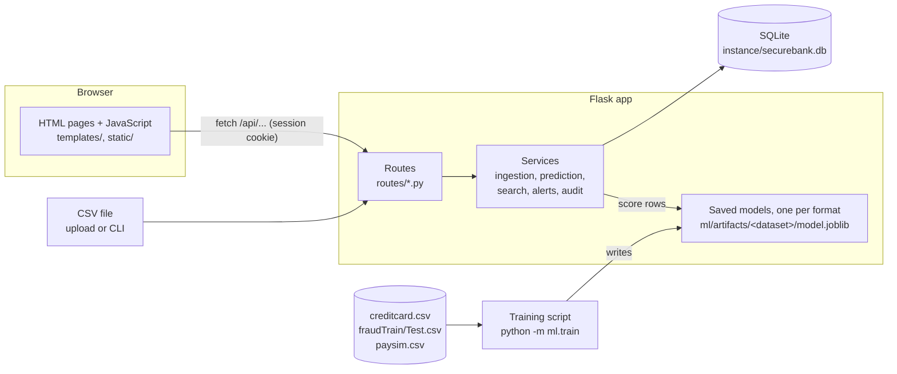
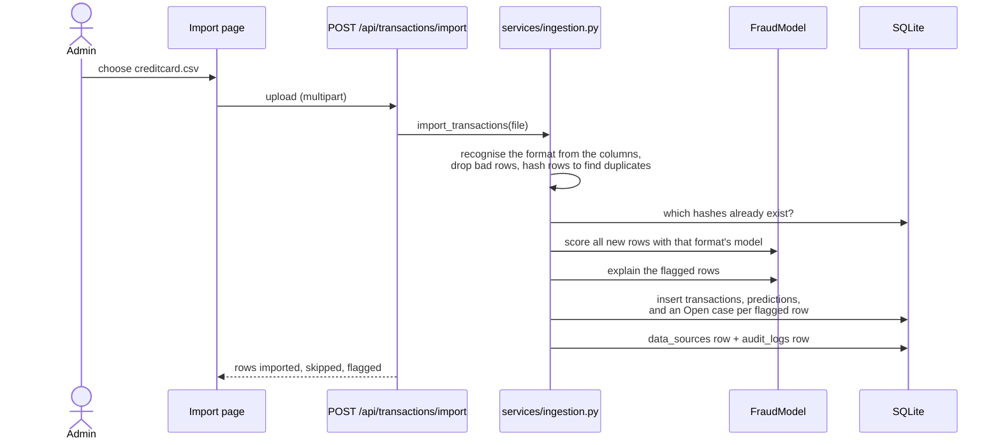
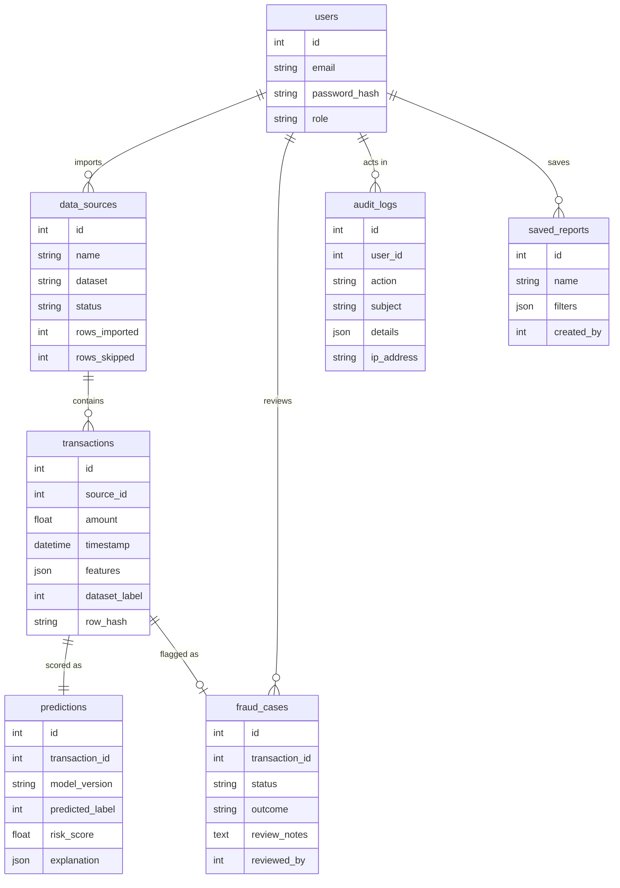

# SecureBank architecture

SecureBank is a single Flask application with a SQLite database and scikit-learn models saved to disk, one per data format. A browser loads HTML pages from Flask, and each page's JavaScript calls the app's JSON API.

## Components

| Layer | Files | Job |
|---|---|---|
| Pages | `templates/`, `static/js/`, `static/css/` | Show data and forms. They hold no business logic and only call the API. |
| Routes | `routes/*.py` | Check login and role, validate input, and return JSON or HTML. |
| Services | `services/*.py` | Import, scoring, search and reports, case rules and audit logging, kept out of the routes so they can be tested and reused by the CLI. |
| Model | `ml/*.py`, `ml/artifacts/` | Data formats (`datasets.py`), training, evaluation, explanations, and a `FraudModel` class that loads a saved pipeline. |
| Data | `models.py`, `instance/securebank.db` | Seven tables, described below. |

## What happens when a file is imported

## Data model

The imported record, the model's prediction and the analyst's outcome sit in three separate tables. A reviewer marking a case "Legitimate" never changes what the model predicted, so the two can be compared later. `dataset_label` keeps the Kaggle `Class` value for evaluation only, and the app never uses it to make decisions.

A saved report stores only its name and the search filters, never a copy of the results. Opening it runs the search again (`services/search.py`), so its totals, case counts and CSV download always match the current data.

## The models

Each dataset format has its own model, because the formats share no columns. `ml/datasets.py` describes each format: its required columns, how rows are cleaned, which columns are stored, and how the model inputs are built.

| Format | Data | Split | Model inputs | Saved model | Test PR-AUC | Precision | Recall |
|---|---|---|---|---|---|---|---|
| `creditcard` | 284,807 card payments, 492 frauds; 1,081 duplicates dropped | 60/20/20, stratified | `Time`, `V1` to `V28`, `Amount` | Gradient Boosting, threshold 0.935 | 0.858 | 0.925 | 0.779 |
| `sparkov` | 1,852,394 simulated US card payments, 9,651 frauds | `fraudTrain.csv` 75/25 into train and validation; `fraudTest.csv`, six months later, is the test set | amount, hour, night-time, day of week, age, city population, customer-to-merchant distance, merchant category | Gradient Boosting, threshold 0.922 | 0.869 | 0.849 | 0.767 |
| `paysim` | 6,362,620 simulated mobile-money transfers, 8,213 frauds; 543 duplicates dropped | 60/20/20, stratified; training cut to 1 million rows, keeping every fraud | type, amount, the four balances, account emptied, balance mismatches, hour | Random Forest, threshold 0.756 | 0.999 | 1.000 | 0.998 |

- **Pipeline:** `StandardScaler`, then `SMOTE`, then the classifier. SMOTE runs only while fitting, so validation and test rows are never resampled.
- **Candidates:** Logistic Regression, Decision Tree, Random Forest, a linear SVM and Gradient Boosting (`HistGradientBoostingClassifier`).
- **Selection:** the highest PR-AUC on the validation set picks the model. Its alert threshold is the one that gives the best F1 on the validation set. The test set is scored once, at the end.
- **Gradient Boosting needs regularisation.** Without an L2 penalty on its leaves, it fell apart on PaySim (validation PR-AUC 0.02), because leaves holding only SMOTE-made fraud rows got extreme values. With `l2_regularization=1.0` it reached 0.997.
- **Fairness:** Sparkov includes each customer's gender. It is neither stored nor used, so the model cannot score men and women differently. An earlier version used it, and it showed up as a reason for some alerts. Names, street, job, ZIP code and the full card number are also never stored.
- **PaySim's caveat:** its near-perfect score comes from the simulator. Its fraudulent transfers almost always empty the account and leave balances that do not add up, which makes them easy to spot. Real data would not be this clean, so the Sparkov result is the better guide to real-world performance.
- **Step 1's model:** Random Forest on the credit card data, with test PR-AUC 0.787. Gradient Boosting now catches 74 of the 95 test frauds instead of 69, with 6 false alerts instead of 9.

### Why a transaction was flagged

`ml/explain.py` explains each flagged transaction by occlusion. Inputs are grouped (for example, all merchant category columns form one group). For each group, the transaction's values are replaced by those of a typical genuine transaction (the training median, or the most common category) and the transaction is scored again. The drop in score is that group's effect. The three groups with the biggest effects, of at least 0.001, are stored with the prediction as `[{feature, value, typical, effect}]`.

This works the same for every model type, and the typical values are saved in `model_meta.json`, so explanations need no training data at run time. Effects are not additive and ignore interactions between groups, so they say which inputs mattered most, not exactly how much each one contributed.

## Security

| Risk | Protection | Where |
|---|---|---|
| Stolen or guessed passwords | Passwords are stored as salted scrypt hashes and never in plain text. Login errors read the same for unknown emails and wrong passwords. | `models.User`, `routes/auth.py` |
| Password guessing | After 5 failed logins for one email from one IP address within 15 minutes, logins are refused with HTTP 429. The count resets after a successful login. | `services/audit.py`, `routes/auth.py` |
| Unauthorised access | Every page and API route needs a login. Importing and the audit log need the admin role. | `routes/auth.py` (`role_required`), `routes/pages.py` |
| Cross-site request forgery | Session cookies are `SameSite=Lax` and `HttpOnly`. API writes whose `Origin` header names another site are rejected. | `config.py`, `app.py` (`reject_cross_site_writes`) |
| Cross-site scripting | Pages insert user text with `textContent` only. A strict Content-Security-Policy allows only the app's own scripts and styles, with no inline code, and a test checks every page for inline code. | `static/js/common.js`, `app.py` |
| Clickjacking, MIME sniffing, caching | `X-Frame-Options: DENY`, `frame-ancestors 'none'`, `X-Content-Type-Options: nosniff`, and `Cache-Control: no-store` on API responses. | `app.py` (`security_headers`) |
| Open redirect after login | `?next=` only follows paths on the same site. | `routes/pages.py` (`_safe_next`) |
| Bad uploads | Files over 200 MB are refused. Files must be CSV with the expected columns, and invalid rows are skipped and counted. | `config.py`, `services/ingestion.py` |
| Untraceable changes | Logins, failed logins, imports, case changes, new users, and saved, deleted and downloaded reports are written to `audit_logs`, in the same transaction as the change. | `services/audit.py` |
| Spreadsheet formula injection | Text cells in CSV downloads that start with `=`, `+`, `-` or `@` get a leading `'`, so a spreadsheet shows them instead of running them. Downloads are capped at `EXPORT_MAX_ROWS` (100,000) and each one is audited. | `services/search.py`, `routes/reports.py` |
| Leaked secrets or data | `SECRET_KEY` comes from the environment. The dataset, database and trained model are git-ignored. | `config.py`, `.gitignore` |

The app never asks for or stores bank passwords, PINs, CVVs, OTPs or access tokens. A real bank integration would go through an authorised provider's API and consent flow, as section 10 of the project spec describes.

### Known limits

- The login limit counts attempts in the database, keyed by email and IP address. Someone using many IP addresses could still guess slowly. A production system would add a per-account lock and multi-factor login.
- `flask run` serves plain HTTP. In production, put the app behind HTTPS and set `SESSION_COOKIE_SECURE=1`.
- SQLite suits one server. The spec's planned move to PostgreSQL only needs `DATABASE_URL` changed, plus one SQLite-specific `strftime` call in `routes/dashboard.py`.
- A score above the threshold opens a case for a person to review. It never blocks a payment.
